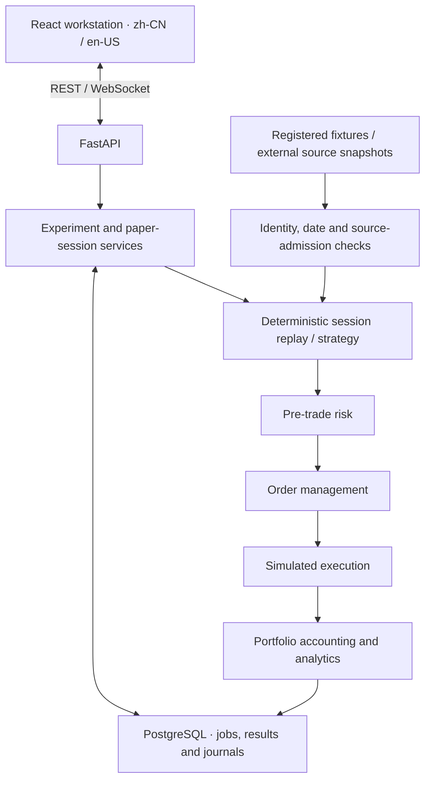

# Quant Trading Platform

### From data provenance to a persisted, explainable simulation.

A local-first quantitative research and paper-trading workstation for China A-shares.
Built with **FastAPI, React, TypeScript and PostgreSQL**, it connects data eligibility,
deterministic execution, portfolio accounting and a bilingual research interface.


**English** · [简体中文](README.zh-CN.md) · [Quick start](#quick-start) · [Architecture](#architecture) · [Engineering decisions](#engineering-decisions) · [User guide](docs/product/USER_GUIDE.en-US.md)

> **Version and safety:** `v1.1.0` is the released research baseline. This branch contains
> **v1.2 Product Experience Edition, still in development**. No live broker, real-money
> execution or profitability claim. A fresh installation can run the bundled synthetic demo;
> real-market execution has separate, currently unmet data-acceptance gates.

## Product preview


*A real v1.2 development capture: four-step research setup, a visible configuration summary,
and explicit confirmation. This retained September 2026 view selects historical exploration;
it does not establish that historical execution is currently admitted.*

<details>
<summary>View the strategy explanation in dark mode</summary>


*Captured on 2026-10-03: explain selection rules, execution timing and limitations before
configuration. These are retained UI captures, not a fresh runtime check or v1.2 release
acceptance. [Screenshot provenance and checksums](docs/SCREENSHOTS.md).*

</details>

## What this project does

The central problem is not merely producing an equity curve. It is keeping the **input data,
decision time, execution rules, accounting and displayed result consistent and traceable**.

| Area | Implemented capability |
|---|---|
| Research workstation | Chinese/English UI, light/dark themes, guided setup, saved drafts and configuration versions, strategy explanations and task navigation. |
| Experiment lifecycle | PostgreSQL-backed jobs, idempotent submission, progress, cancellation, persisted results, explicit retry after interruption and configuration-aware comparison. |
| Execution and accounting | Shared risk → order management → simulated fills → portfolio path; cash, positions, fees and corporate actions are accounted for server-side. |
| Paper accounts | Durable session/order/fill journals, REST snapshots and WebSocket updates, constrained plans and recovery of committed state. Registered synthetic/replay modes are not real-market forward trading. |
| Data lineage | Stable security identities, point-in-time facts, raw/adjusted price separation, SHA-256 manifests and explicit source-admission checks. Viewing a source does not authorize its execution. |
| Inspectable results | Metrics, benchmark comparisons, equity/drawdown, holdings, trades, risk reasons and exports with dataset/configuration/implementation lineage. |

**Supported local workflows:** registered synthetic research and fixture-based demonstrations.
Historical archives remain inspectable where mounted. New historical executions are blocked
by known source/economic-integrity gaps; real-market forward mode remains unavailable.
See [current capabilities and remaining work](#current-capabilities-and-remaining-work).

## Architecture

A **modular monolith**, deliberately scoped to one local user and one backend process.
Domain logic is separated from API, storage and UI concerns; it is not a microservice cluster.



- **Financial authority stays in the backend.** Exact decimal strings cross the API;
  `Decimal` and PostgreSQL `NUMERIC(78,38)` preserve financial values. React renders them.
- **No distributed-system claims.** Event dispatch and WebSocket delivery are in-process.
  Jobs use PostgreSQL ownership and a single worker. Redis is provisioned in Compose,
  but is not the application's job queue or event bus.
- **Large artifacts stay outside Git.** Parquet datasets, raw market files and local evidence
  are mounted separately; schemas, manifests, policies and audit code remain reviewable.

[Architecture detail](ARCHITECTURE.md) · [Research methodology](docs/research/METHODOLOGY.md) · [Corporate-action policy](docs/research/CORPORATE_ACTION_POLICY.md)

## Engineering decisions

These are useful starting points for a technical walkthrough of the codebase.

| Constraint | Design choice | Read the implementation |
|---|---|---|
| Floating-point rounding must not silently alter money. | Validate finite decimal-string inputs and precision/scale; persist exact financial values and reject overflow. | [Decimal boundary](backend/app/application/backtests/decimal_policy.py), [API round-trip tests](backend/tests/test_backtest_api.py) |
| A strategy must not trade on information it has not yet observed. | Process previously submitted orders before completed-session signals; use raw-price fills and explicit session expiry. Unestablished fill conditions mean no fill. | [Research engine](backend/app/research/engine.py), [execution tests](backend/tests/test_research_execution_engine.py), [daily-bar convention](docs/research/DAILY_EXECUTION_CONVENTION.md) |
| Refresh, duplicate submission or a restart must not invent a successful run. | Canonical configuration hashes, idempotency, database ownership and persisted lifecycle states. Interrupted experiments require explicit retry, not a claimed mid-job resume. | [Experiment service](backend/app/application/experiments/service.py), [persistence models](backend/app/db/models/experiments.py) |
| Accessible data are not necessarily qualified trading inputs. | Separate catalogue/read access from execution admission; bind receipts to content hashes and validate source eligibility. | [Dataset admission](backend/app/application/experiments/data.py), [paper admission](backend/app/application/paper_trading/source_admission.py), [receipt cache](backend/app/application/market_updates/cache.py) |
| Two runs are not comparable just because their curves overlap. | Surface configuration differences and carry dataset, configuration, implementation and cost/risk metadata into exports; protect CSV cells against formula interpretation. | [Comparison UI](frontend/src/product/experiments/), [export service](backend/app/application/experiments/export.py) |
| A test suite must never clear the user's research database. | Separate Compose project, disposable `quant_test` storage, and configuration/pytest guards that reject application database targets. | [Test Compose](compose.test.yml), [test guard](backend/tests/conftest.py), [CI](.github/workflows/ci.yml) |

### Stack

| Layer | Technologies |
|---|---|
| Backend | Python 3.12, FastAPI, Pydantic, SQLAlchemy 2, asyncpg, Alembic |
| Frontend | React 19, TypeScript 6, Vite 8, i18next, REST + WebSocket |
| Storage and research | PostgreSQL 16, PyArrow/Parquet, `Decimal`, SHA-256 manifests |
| Delivery and checks | Docker Compose, GitHub Actions, pytest, Vitest/Testing Library, Ruff, mypy, ESLint, TypeScript checks |

## Quick start

**Fresh installation:** requires repository access, Git, Make, and Docker with Compose.
On Windows, use Ubuntu WSL2 with Docker Desktop's WSL integration enabled. The containers
provide the Python and Node toolchains; host Python/Node installation is not required.

The explicit branch selects the v1.2 workstation described here; `main` remains the released baseline.

```bash
git clone --branch codex/product-v1.2-current-rules \
  https://github.com/MakenzieAhern/quant-trading-platform.git
cd quant-trading-platform
cp .env.example .env
make up
```

`make up` builds the services, applies Alembic migrations during backend startup, and waits
for health checks. Open [the workstation](http://localhost:5173/),
[API health](http://localhost:8000/api/health), or [OpenAPI](http://localhost:8000/docs).

### Try the synthetic demo

1. Choose **Start guided backtest** from the workbench; select the registered strategy.
2. In the data step, explicitly choose **Synthetic demo** and review its supplied dates and universe.
3. Review capital, simulated costs and risk limits; acknowledge the summary before running.
4. Open the task, wait for **Complete**, then refresh the result to inspect persisted metrics,
   trades and risk reasons. Try saved configurations and result comparison.

The bundled scenario contains **10 synthetic securities in 2030–2031**. No private historical
archive, market-provider account or external market download is needed. Its returns are
demonstration output, not A-share evidence. [Full bilingual walkthrough](docs/product/DEMO.md).

**Existing installation:** use the existing checkout and configuration; do not reclone,
overwrite `.env`, replace data or rerun initial setup. `make down` stops this stack while
preserving its named volumes. Never use volume deletion as a setup or test workaround.

## Testing and verification

```bash
make test   # isolated backend + frontend test stack
make lint   # Ruff, formatting, mypy, ESLint and TypeScript checks
make build  # frontend production build
```

`make test` uses the separate `quant-mvp-tests` Compose project and a disposable PostgreSQL
`quant_test` database on tmpfs. Do not run pytest against the application database.
CI additionally checks Alembic upgrade/downgrade/upgrade consistency, schema drift,
Compose configuration and a clean-install release smoke test.

**Last verified code checkpoint:** [`d2398c1`](https://github.com/MakenzieAhern/quant-trading-platform/commit/d2398c1827286a896b975b8d026a857d286427bd),
2026-10-18 UTC — [GitHub Actions evidence](https://github.com/MakenzieAhern/quant-trading-platform/actions/runs/39082235110).

| Check | Recorded result |
|---|---|
| Backend | 2,362 passed; 1 optional archive-dependent test skipped |
| Frontend | 990 passed across 55 test files |
| Static checks and build | Python lint/format/types and frontend lint/types/build passed |
| Database and integration | Migration checks and Compose release smoke passed |

These are checkpoint results, not a claim of universal correctness, current service uptime
or complete product acceptance. [Acceptance ledger](docs/product/ACCEPTANCE.md).

## Research archive and honest results

The released [v1.1.0 research baseline](https://github.com/MakenzieAhern/quant-trading-platform/releases/tag/v1.1.0)
records a frozen **2010–2025** artifact with **5,431 securities**, **3,886 sessions**,
**13,411,189 raw daily rows** and **42,792 corporate-action rows**. These describe the
archived artifact, not data bundled with Git or a currently qualified market feed.

Later source/economic-integrity findings prevent new historical execution against that
version. The archive and its unchanged results remain available for inspection where mounted;
previous audit success does not override the current admission gate.

<details>
<summary>Archived strategy result — not evidence of robust alpha</summary>

The frozen cross-sectional momentum / trend / low-volatility strategy did **not** establish
robust historical alpha. No Validation candidate passed every pre-registered robustness gate;
unchanged S4 entered Official OOS as the declared fallback.

| Split | Period | Total return | Sharpe | Maximum drawdown | Excess vs CSI300 |
|---|---|---:|---:|---:|---:|
| Development | 2010–2017 | -21.75% | -0.434 | -32.56% | -35.77% |
| Validation | 2018–2021 | -5.17% | -0.141 | -11.98% | -26.04% |
| Official OOS | 2022–2025 | 0.76% | 0.067 | -15.70% | 6.61% |

These are preserved archival outputs, subject to the current data-quality caveats above,
not newly validated performance. Official OOS ran once; it is not rerun to improve the result.
[Strategy report](docs/research/STRATEGY_REPORT.md) · [OOS report](docs/research/OOS_REPORT.md) · [Dataset lineage](docs/research/DATASET.md).

</details>

## Current capabilities and remaining work

| Status | Scope |
|---|---|
| Available | Local bilingual workstation, guided synthetic experiments, saved results/configurations, comparison/export, fixture demonstrations and read-only archived research where installed. |
| Implemented, not yet admitted for real-market use | Forward-session request/receipt plumbing, persistent context and journals. The qualified real-source verifier registry remains empty; the UI correctly reports forward mode unavailable. |
| Blocked by evidence | New historical research/replay requires closure of source/economic-integrity gaps. Real-market forward simulation separately requires lawful source use, complete effective-dated facts and a genuine post-start trading-day acceptance run. |
| In progress | Remaining product, browser/accessibility and delivery acceptance; v1.2 is not released. |
| Outside scope | Live trading, public multi-user hosting, Hong Kong/US market expansion and ML/GPU strategy work. |

[Product roadmap](docs/product/PRODUCT_MASTER.md) · [Source readiness](docs/product/SOURCE_READINESS.md) · [Acceptance evidence](docs/product/ACCEPTANCE.md)

## Code and documentation map

```text
backend/app/
  api/                 REST schemas and endpoints
  application/         Experiment, paper-account and market-data workflows
  research/            Point-in-time research and execution engine
  risk/ execution/     Pre-trade checks and order management
  portfolio/ db/       Accounting and durable models
frontend/src/          React routes, product flows, components and translations
docs/product/          User guides, design decisions and acceptance evidence
docs/research/         Methodology, provenance, policies and archived reports
```

Start with [architecture](ARCHITECTURE.md), the [English user guide](docs/product/USER_GUIDE.en-US.md),
[中文操作指南](docs/product/USER_GUIDE.zh-CN.md), [reproducibility](docs/research/REPRODUCIBILITY.md)
or [research limitations](docs/research/LIMITATIONS.md).

## Safety and data rights

This is an **unauthenticated, loopback-only, single-user research tool**, not a public service.
Do not expose its ports to the internet. It has no live-broker adapter and sends no real-money
orders. Keep `.env`, credentials, raw datasets, database dumps and private evidence out of Git.

Public SDK access does not establish market-data usage or redistribution rights. No
project-wide open-source license is currently included; source access is not an implied
license to redistribute code or data. Research and education only, not investment advice.
