# Quant Trading Platform

**Current checkout: v1.2 Product Experience Edition in development.** The released
scientific baseline below is **v1.1.0 — China A-Share Research Edition**; v1.2 is not
released. Start at the [local workbench](http://localhost:5173/) and use the
[中文操作指南](docs/product/USER_GUIDE.zh-CN.md) or
[English user guide](docs/product/USER_GUIDE.en-US.md). The
[product master](docs/product/PRODUCT_MASTER.md) records the full v1.2 scope and
remaining acceptance gates.

For a safe first look, follow the [bilingual synthetic A-share demo](docs/product/DEMO.md).

A deterministic, point-in-time quantitative research and paper-trading platform for ordinary
SSE/SZSE A-shares. It combines a 2010–2025 audited research dataset, corporate-action-aware
portfolio accounting, pre-trade risk, OMS, simulated execution, PostgreSQL persistence, REST and
WebSocket APIs, and one bilingual React application (`zh-CN` / `en-US`).

> **PAPER / SIMULATED ONLY. NO LIVE BROKER. NO REAL-MONEY EXECUTION.**

Research did not establish robust historical alpha. The official OOS result was weakly positive,
but is not evidence of reliable profitability and does not predict future returns.

## What v1.1 demonstrates

- Point-in-time master for 5,431 historically validated ordinary A-share securities across SSE
  Main/STAR and SZSE Main/ChiNext, including listed and delisted names.
- 3,886 trading sessions, 13,411,189 raw daily rows and 42,792 corporate-action rows from
  2010-01-01 through 2025-12-31.
- Survivorship, future-IPO, delisting-retention, ST/*ST, suspension, market-rule and
  corporate-action controls audited before the dataset freeze.
- Raw prices for execution and separately audited adjusted history for factors—never adjusted
  prices as fills.
- Deterministic cross-sectional momentum, trend and low-volatility research using `Decimal`,
  stable identities and checksummed inputs.
- A fixed Development / Validation / Official OOS protocol with an immutable one-run OOS lock.
- Shared RiskEngine → OMS → simulated broker → Portfolio accounting for research and local paper
  execution.
- PostgreSQL research/paper ledgers and a typed React dashboard with lineage, benchmark, equity,
  drawdown, rolling metrics, monthly returns, holdings, rebalances and trades.

## Scientific result

The frozen strategy is `cn_a_cross_sectional_momentum_low_vol_v1` (S4). No Validation candidate
passed every pre-registered robustness gate, so unchanged S4 entered OOS as the declared fallback.

| Split | Period | Total return | Sharpe | Maximum drawdown | Excess vs CSI300 |
|---|---|---:|---:|---:|---:|
| Development | 2010–2017 | -21.75% | -0.434 | -32.56% | -35.77% |
| Validation | 2018–2021 | -5.17% | -0.141 | -11.98% | -26.04% |
| Official OOS | 2022–2025 | 0.76% | 0.067 | -15.70% | 6.61% |

Official OOS ran exactly once. Its result SHA-256 is
`ccf5bd2f82f145c9d14bb6ffb912bf035d276b46b8056883b8a18a61a2d92e8c`. See
[the OOS report](docs/research/OOS_REPORT.md) and
[strategy report](docs/research/STRATEGY_REPORT.md).

## Architecture

```mermaid
flowchart LR
    A[Official/public source snapshots] --> B[Immutable dataset + SHA-256 manifest]
    B --> C[Point-in-time sessions]
    C --> D[Factors + frozen strategy]
    D --> E[RiskEngine]
    E --> F[OMS]
    F --> G[Simulated execution]
    G --> H[Portfolio + analytics]
    H --> I[PostgreSQL research/paper ledger]
    I --> J[REST / WebSocket]
    J --> K[React zh-CN / en-US]
```



Financial values remain `Decimal` / PostgreSQL `NUMERIC(78,38)` / exact JSON strings. Strategies
consume completed sessions only. Orders use the conservative
[`CN_A_DAILY_OPENING_LIMIT_V1`](docs/research/DAILY_EXECUTION_CONVENTION.md) daily-bar convention;
unestablished execution conditions fail closed as no fill. React never recalculates financial
state. See [ARCHITECTURE.md](ARCHITECTURE.md).

## v1.1 baseline surfaces

- `/research/a-share` — frozen dataset and formal Development/Validation/OOS ledger.
- `/research/a-share/strategies` — formulas, frozen configuration and methodology notes.
- `/research/a-share/datasets/:id` — canonical lineage and manifest.
- `/research/a-share/runs/:id` — metrics, CSI300 comparison, curves and audit tables.
- `/paper` — durable local paper/simulated sessions for the registered AAPL replay or the frozen
  A-share strategy on a deterministic synthetic 2030 scenario, with REST snapshots and WebSocket
  updates. The synthetic scenario is product validation, not research evidence, and never replays
  Official OOS.
- `/backtests` — deterministic registered-fixture regression/demo backtests retained from v1.0.

## Quick start (fresh installation only)

Requires Docker Desktop/Engine with Compose. On Windows, run from Ubuntu WSL2 with Docker Desktop
WSL integration enabled. Do not clone again or repeat initial setup on an existing PC; start its
existing Compose services instead. Docker Desktop may require a manual launch after Windows login.

```bash
git clone https://github.com/MakenzieAhern/quant-trading-platform.git
cd quant-trading-platform
cp .env.example .env
make setup
make up
```

Open [the workbench](http://localhost:5173/),
[API health](http://localhost:8000/api/health), or [OpenAPI](http://localhost:8000/docs).
`make down` preserves PostgreSQL and Redis volumes.

Large market data is deliberately excluded from Git. To publish the already-generated immutable
formal results into a local PostgreSQL ledger, mount the audited dataset/result directories and run:

```bash
PYTHONPATH=backend python backend/scripts/publish_formal_research.py \
  --dataset /data/research/cn-a-research-20100101-20251231-v1 \
  --development /data/research/runs/r6-development-v5 \
  --validation /data/research/runs/r7-validation-v1 \
  --oos /data/research/runs/r8-official-oos-v1
```

The publisher verifies immutable result lineage and is idempotent. Do **not** rerun Official OOS;
the one-run authorization is consumed.

## Verification

```bash
make test
make lint
make build
```

CI uses disposable PostgreSQL storage and validates Alembic, Python, TypeScript, frontend tests and
Compose configurations. `APP_ENV=test` requires a `quant_test` or `quant_test_*` database;
shared configuration rejects application targets before connecting, including scripts and Alembic.
The pytest runner also requires test mode. See [reproducibility](docs/research/REPRODUCIBILITY.md),
[dataset lineage](docs/research/DATASET.md), [bias controls](docs/research/BIAS_CONTROLS.md), and
[limitations](docs/research/LIMITATIONS.md).

## Safety and scope

The application is an unauthenticated, loopback-only, single-user research tool. It contains no
live-broker adapter or brokerage credentials and is not approved for public-internet deployment.
Hong Kong/US expansion, real-money trading, and ML/GPU strategy work are outside v1.1.

Research and education only. Simulated results are not financial advice and do not guarantee
future performance.
