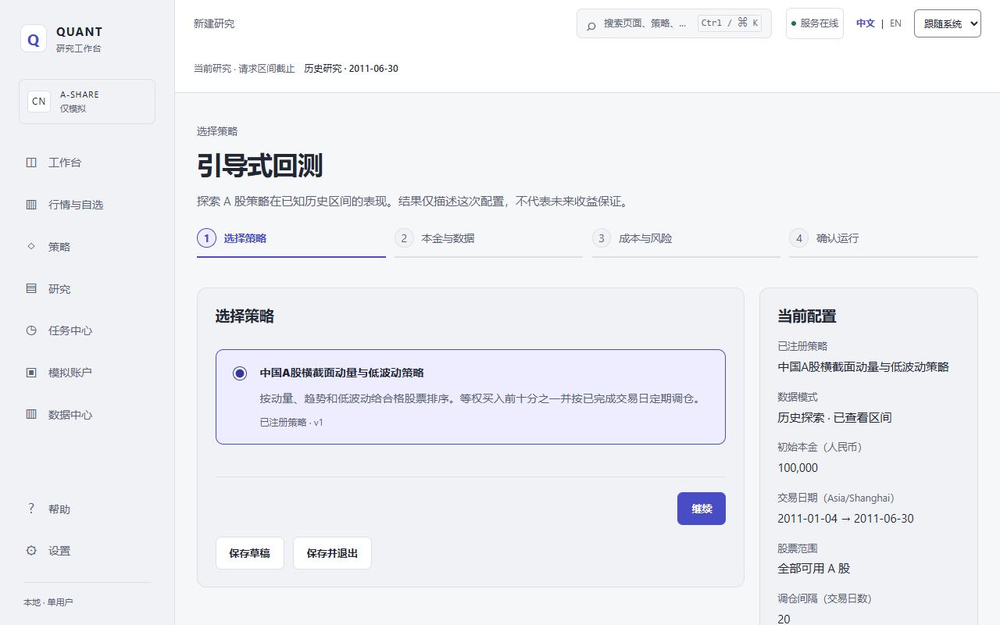
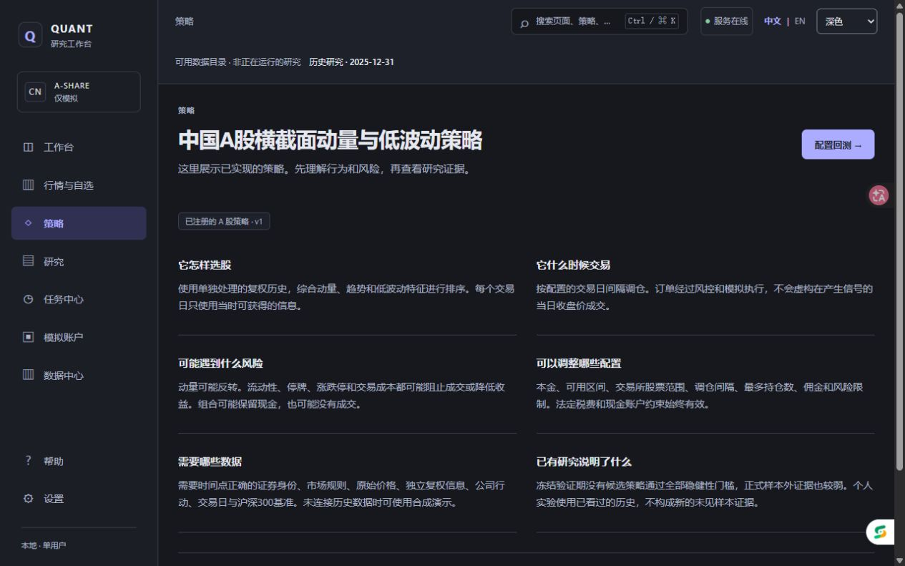
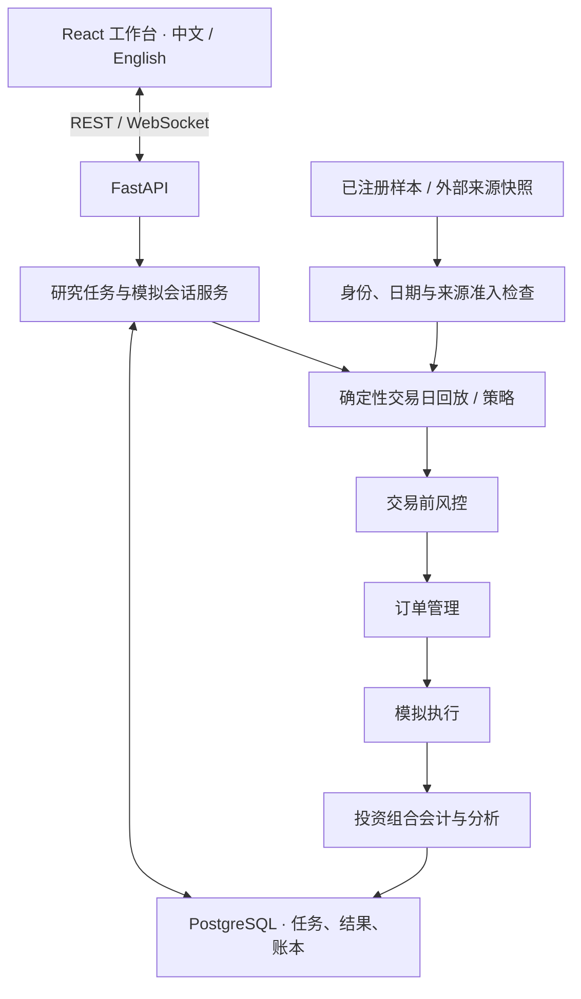

# Quant Trading Platform · 量化研究工作台

### 从数据溯源，到可持久化、可解释的模拟结果。

面向中国 A 股的本地优先量化研究与模拟交易平台。基于 **FastAPI、React、TypeScript 和 PostgreSQL**，
将数据准入、确定性执行、投资组合会计与双语研究界面连接成一条可追踪的链路。


[English](README.md) · **简体中文** · [快速开始](#快速开始) · [系统架构](#系统架构) · [工程设计取舍](#工程设计取舍) · [操作指南](docs/product/USER_GUIDE.zh-CN.md)

> **版本与安全边界：** `v1.1.0` 是已发布的研究基线，当前分支是**仍在开发中的 v1.2 产品体验版**。
> 不连接实盘券商，不发送真实资金订单，不宣称策略盈利。全新安装可运行内置合成演示；
> 真实市场数据的执行另有准入条件，目前尚未全部满足。

## 界面预览



*真实 v1.2 开发界面：四步研究向导、可见的配置摘要、运行前主动确认。
这是保留的 2026 年 9 月界面截图，其中选中的是历史探索模式，不代表当前历史执行已经获准。*

<details>
<summary>展开查看深色模式下的策略说明</summary>



*2026-10-03 实际截图：先解释如何选股、何时交易及可能失效的原因，再进入配置。
这些是保留的界面证据，不是本次启动检查或 v1.2 完整发布验收。
[截图来源与校验值](docs/SCREENSHOTS.md)。*

</details>

## 项目解决什么问题

项目的重点不只是画出一条收益曲线，而是让**输入数据、决策时点、成交规则、账户会计和最终展示保持一致，并且能够追溯**。

| 模块 | 已实现能力 |
|---|---|
| 研究工作台 | 中英文切换、明暗主题、引导式配置、草稿与配置版本、策略解释及任务导航。 |
| 实验生命周期 | PostgreSQL 持久化任务、幂等提交、进度、取消、结果保存、中断后显式重试，以及带配置差异的结果比较。 |
| 执行与会计 | 共用风控 → 订单管理 → 模拟成交 → 投资组合链路；现金、持仓、费用及公司行动统一由后端核算。 |
| 模拟账户 | 持久化会话/订单/成交账本、REST 快照、WebSocket 更新、受约束的执行计划及已提交状态恢复。已注册合成/回放模式不等于真实行情前向模拟。 |
| 数据溯源 | 稳定证券标识、时间点事实、原始价与复权价分离、SHA-256 清单和来源准入检查；能查看数据不等于能用于执行。 |
| 结果解释 | 指标、基准比较、权益/回撤、持仓、交易、风控原因，以及携带数据/配置/实现版本信息的导出。 |

**支持的本地流程：** 已注册的合成研究和固定样本演示。已挂载的历史档案仍可查看；
新历史执行因已知来源/经济口径完整性问题被保护性阻断，真实行情前向模式尚未开放。
详见[当前能力与后续工作](#当前能力与后续工作)。

## 系统架构

采用**模块化单体**，明确面向本地单用户、单后端进程。领域逻辑与 API、存储、界面分层，
不将系统描述为微服务集群。



- **金融结果以后端为准。** API 使用精确十进制字符串，后端使用 `Decimal`，数据库使用
  `NUMERIC(78,38)`；React 负责展示，不维护另一套金融计算结果。
- **不夸大分布式能力。** 事件分发和 WebSocket 在进程内运行，任务采用 PostgreSQL 所有权控制与单工作器。
  Compose 配置了 Redis，但它不是应用当前的任务队列或事件总线。
- **大型数据不进 Git。** Parquet 数据集、原始行情和本地证据独立挂载；仓库保留可审查的结构、清单、政策及审计代码。

[架构详解](ARCHITECTURE.md) · [研究方法](docs/research/METHODOLOGY.md) · [公司行动会计政策](docs/research/CORPORATE_ACTION_POLICY.md)

## 工程设计取舍

以下入口适合代码审查，也适合在技术面试中深入讨论具体实现。

| 约束 | 设计选择 | 代码入口 |
|---|---|---|
| 浮点误差不能悄悄改变金额。 | 在 API 边界验证有限十进制字符串及精度/小数位，精确持久化，溢出时拒绝而非截断。 | [精度边界](backend/app/application/backtests/decimal_policy.py)、[API 往返测试](backend/tests/test_backtest_api.py) |
| 策略不能用尚未发生的信息成交。 | 先处理之前提交的订单，再从已完成交易日生成信号；使用原始价成交及明确的订单有效期，成交条件不能成立时不成交。 | [研究引擎](backend/app/research/engine.py)、[执行测试](backend/tests/test_research_execution_engine.py)、[日线执行约定](docs/research/DAILY_EXECUTION_CONVENTION.md) |
| 刷新、重复提交或进程重启不能制造“成功结果”。 | 规范化配置哈希、幂等提交、数据库所有权与持久化生命周期；中断实验需要显式重试，不声称中途无缝续跑。 | [实验服务](backend/app/application/experiments/service.py)、[持久化模型](backend/app/db/models/experiments.py) |
| 可访问的数据不一定具备交易输入资格。 | 目录/读取权限与执行准入分离，回执绑定内容哈希，并验证来源资格。 | [数据集准入](backend/app/application/experiments/data.py)、[模拟准入](backend/app/application/paper_trading/source_admission.py)、[回执缓存](backend/app/application/market_updates/cache.py) |
| 两条曲线放在一起不等于可比实验。 | 展示配置差异，导出携带数据集、配置、实现及成本/风险元数据，同时防止 CSV 单元格被解释为公式。 | [比较界面](frontend/src/product/experiments/)、[导出服务](backend/app/application/experiments/export.py) |
| 测试不能清空用户的研究数据库。 | 独立 Compose 项目、一次性 `quant_test` 存储，以及拒绝应用数据库目标的配置/pytest 防护。 | [测试 Compose](compose.test.yml)、[测试防护](backend/tests/conftest.py)、[CI](.github/workflows/ci.yml) |

### 技术栈

| 层次 | 技术 |
|---|---|
| 后端 | Python 3.12、FastAPI、Pydantic、SQLAlchemy 2、asyncpg、Alembic |
| 前端 | React 19、TypeScript 6、Vite 8、i18next、REST + WebSocket |
| 存储与研究 | PostgreSQL 16、PyArrow/Parquet、`Decimal`、SHA-256 清单 |
| 交付与检查 | Docker Compose、GitHub Actions、pytest、Vitest/Testing Library、Ruff、mypy、ESLint、TypeScript 检查 |

## 快速开始

**全新安装：** 需要仓库访问权限、Git、Make 和支持 Compose 的 Docker。
Windows 请在 Ubuntu WSL2 内运行，并启用 Docker Desktop 的 WSL 集成。
Python 与 Node 工具链由容器提供，无需在宿主机额外安装。

下方明确选择当前 v1.2 工作台分支；`main` 仍是已发布基线。

```bash
git clone --branch codex/product-v1.2-current-rules \
  https://github.com/MakenzieAhern/quant-trading-platform.git
cd quant-trading-platform
cp .env.example .env
make up
```

`make up` 构建并启动服务，后端启动时执行 Alembic 迁移，然后等待健康检查。
打开[工作台](http://localhost:5173/)、[API 健康检查](http://localhost:8000/api/health)
或 [OpenAPI 文档](http://localhost:8000/docs)。

### 体验合成演示

1. 在工作台点击**开始引导式回测**，选择已注册策略。
2. 在数据步骤明确选择**合成演示**，核对页面给出的日期与证券范围。
3. 检查本金、模拟费用和风险限制，阅读摘要并主动确认后运行。
4. 等待任务**已完成**，刷新结果页，检查保存的指标、交易和风控原因；可继续体验配置保存与结果比较。

内置场景包含 **2030–2031 年的 10 只合成证券**，不需要私有历史档案、行情账户或外部行情下载。
演示收益只证明界面/执行链路能够工作，不代表 A 股历史表现。[完整双语演示步骤](docs/product/DEMO.md)。

**已有安装：** 使用现有仓库和配置，不要重新克隆、覆盖 `.env`、替换数据或重做初始化。
`make down` 会停止本项目服务并保留命名卷；不要通过删除卷解决安装或测试问题。

## 测试与验证

```bash
make test   # 隔离的后端与前端测试环境
make lint   # Ruff、格式、mypy、ESLint 与 TypeScript 检查
make build  # 前端生产构建
```

`make test` 使用独立的 `quant-mvp-tests` Compose 项目，以及 tmpfs 上的一次性 PostgreSQL
`quant_test` 数据库。不要针对应用数据库运行 pytest。
CI 还检查 Alembic 升级/降级/再升级一致性、模式漂移、Compose 配置及全新安装发布冒烟流程。

**最近已核验的代码检查点：** [`d2398c1`](https://github.com/MakenzieAhern/quant-trading-platform/commit/d2398c1827286a896b975b8d026a857d286427bd)，
2026-10-18 UTC；[GitHub Actions 证据](https://github.com/MakenzieAhern/quant-trading-platform/actions/runs/39082235110)。

| 检查 | 该检查点结果 |
|---|---|
| 后端 | 2,362 项通过；1 项依赖可选历史档案的测试跳过 |
| 前端 | 55 个测试文件、990 项测试通过 |
| 静态检查与构建 | Python lint/格式/类型，以及前端 lint/类型/构建通过 |
| 数据库与集成 | 迁移检查和 Compose 发布冒烟通过 |

以上是明确版本的历史检查结果，不代表绝对正确、当前服务在线或产品已全面验收。
[完整验收账本](docs/product/ACCEPTANCE.md)。

## 研究档案与如实报告

已发布的 [v1.1.0 研究基线](https://github.com/MakenzieAhern/quant-trading-platform/releases/tag/v1.1.0)
记录了一个覆盖 **2010–2025 年**的冻结档案：**5,431 只证券、3,886 个交易日、13,411,189 条原始日线、42,792 条公司行动记录**。
这些数字描述已归档的数据制品，不代表 Git 内置数据，也不代表当前已有合格实时数据源。

后续发现的来源/经济口径完整性问题阻止了对该版本发起新的历史执行。
挂载后仍可查看档案与未改写的旧结果；过去的审计通过不能覆盖当前准入限制。

<details>
<summary>展开查看归档策略结果：没有证明稳健 Alpha</summary>

冻结的横截面动量/趋势/低波策略**没有证明稳健的历史 Alpha**。
Validation 阶段没有候选通过全部预注册稳健性门槛，因此按原定回退规则，保持不变的 S4 进入正式 OOS。

| 阶段 | 区间 | 总收益 | Sharpe | 最大回撤 | 相对沪深 300 超额 |
|---|---|---:|---:|---:|---:|
| Development | 2010–2017 | -21.75% | -0.434 | -32.56% | -35.77% |
| Validation | 2018–2021 | -5.17% | -0.141 | -11.98% | -26.04% |
| Official OOS | 2022–2025 | 0.76% | 0.067 | -15.70% | 6.61% |

这是受上述数据质量限制约束的原始归档输出，不是重新验证后的收益结论。
Official OOS 只运行一次，不通过重跑改善成绩。
[策略报告](docs/research/STRATEGY_REPORT.md) · [OOS 报告](docs/research/OOS_REPORT.md) · [数据谱系](docs/research/DATASET.md)。

</details>

## 当前能力与后续工作

| 状态 | 范围 |
|---|---|
| 已可使用 | 本地双语工作台、引导式合成实验、结果/配置保存、比较与导出、固定样本演示，以及已安装历史档案的只读查看。 |
| 已有实现，尚未获准用于真实行情 | 前向会话请求/回执链路、持久化上下文与账本；合格真实来源验证器注册表仍为空，界面明确提示前向模式不可用。 |
| 受证据缺口阻塞 | 新历史研究/回放需关闭来源与经济口径完整性缺口；真实行情前向模拟还需合法使用依据、完整有效日期事实，以及真正发生在账户启动之后的交易日验收。 |
| 进行中 | 剩余产品、浏览器/可访问性及交付验收；v1.2 尚未发布。 |
| 不在范围内 | 实盘交易、公开多用户托管、港美股扩展，以及 ML/GPU 策略研究。 |

[产品路线图](docs/product/PRODUCT_MASTER.md) · [来源就绪状态](docs/product/SOURCE_READINESS.md) · [验收证据](docs/product/ACCEPTANCE.md)

## 代码与文档导航

```text
backend/app/
  api/                 REST 数据结构与接口
  application/         实验、模拟账户与行情工作流
  research/            时间点研究与执行引擎
  risk/ execution/     交易前检查与订单管理
  portfolio/ db/       投资组合会计与持久化模型
frontend/src/          React 路由、产品流程、组件和翻译
docs/product/          操作指南、设计决策和验收证据
docs/research/         方法学、溯源、政策与归档报告
```

可以从[架构说明](ARCHITECTURE.md)、[中文操作指南](docs/product/USER_GUIDE.zh-CN.md)、
[English user guide](docs/product/USER_GUIDE.en-US.md)、[复现说明](docs/research/REPRODUCIBILITY.md)
或[研究局限](docs/research/LIMITATIONS.md)开始阅读。

## 安全与数据权利

这是**无登录鉴权、仅绑定本机回环地址的单用户研究工具**，不是公共服务，请勿直接向互联网开放端口。
项目不包含实盘券商适配器，不发送真实资金订单。
`.env`、凭据、原始数据集、数据库备份及私有证据不得提交到 Git。

公开 SDK 能访问数据，不等于拥有使用或再分发许可。仓库目前没有项目级开源许可证；
可访问源代码不代表获得代码或数据再分发授权。仅用于研究与教育，不构成投资建议。
